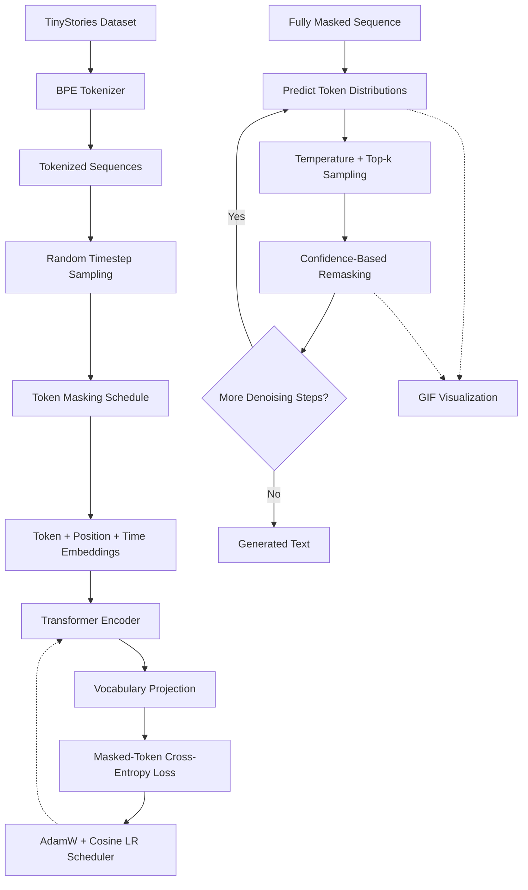

# Tiny Diffusion Language Model

A discrete diffusion language model built from scratch using PyTorch and Transformer Encoders, trained on [TinyStories](https://huggingface.co/datasets/roneneldan/TinyStories). Generates text through iterative denoising instead of conventional left-to-right autoregressive decoding.

## Architecture

The training pipeline teaches the model to reconstruct corrupted sequences. During inference, the model progressively refines a masked sequence until it produces the final text.

## How It Works

Unlike autoregressive models that predict the next token sequentially, this model predicts tokens across the entire sequence using bidirectional attention.

- **Discrete diffusion:** Corrupts token sequences using a timestep-dependent masking schedule.
- **Transformer Encoder:** Uses bidirectional self-attention to learn context from both directions.
- **Timestep conditioning:** Adds learned diffusion timestep embeddings to token and positional embeddings.
- **Masked-token objective:** Computes cross-entropy loss only on corrupted tokens, excluding padding and unmasked positions.
- **Iterative generation:** Predicts tokens, samples candidates, and remasks low-confidence positions over multiple denoising steps.
- **Generation visualization:** Renders the evolving sequence as a retro terminal-style GIF.

## Model Architecture

| Component | Configuration |
|---|---|
| Architecture | Transformer Encoder |
| Parameters | ~13.84M |
| Transformer layers | 6 |
| Attention heads | 6 |
| Hidden dimension | 384 |
| Maximum sequence length | 256 tokens |
| Vocabulary size | 8,000 |
| Diffusion timesteps | 64 |
| Tokenizer | Custom BPE, trained from scratch |

**Weight tying:** The token embedding matrix is shared with the language modeling head to reduce redundant parameters.

## Training Pipeline

1. **Tokenizer training:** Train a Byte-Pair Encoding tokenizer on the dataset using Hugging Face Tokenizers.
2. **Sequence corruption:** Sample a diffusion timestep and mask tokens according to a linear noise schedule.
3. **Denoising objective:** Predict the original tokens at corrupted positions using cross-entropy loss.
4. **Optimization:** Train with AdamW, learning-rate warm-up, and cosine decay.
5. **Mixed precision:** Use Hugging Face Accelerate for distributed-ready training and FP16 execution where supported.

## Inference

Generation starts with a sequence of `[MASK]` tokens.

At each denoising step:

1. Run the complete sequence through the Transformer Encoder.
2. Obtain token probability distributions for all positions.
3. Sample candidate tokens using temperature scaling and top-k filtering.
4. Evaluate prediction confidence and remask selected low-confidence positions according to the next noise level.
5. Repeat until the final denoising step and decode the resulting token sequence.

This predict-and-remask strategy allows uncertain positions to be revised instead of permanently committing to every prediction immediately.

## Generation Visualization

The project includes a custom GIF renderer that visualizes the denoising trajectory.

- **Pillow:** Draws terminal-style frames with neon effects, scanlines, and progress indicators.
- **ImageIO:** Combines frames into an animated GIF.
- **Step-by-step visualization:** Shows how masked positions are progressively replaced and revised throughout generation.

Example output: `inference_cool.gif`

## Tech Stack

`Python` · `PyTorch` · `Hugging Face Tokenizers` · `Transformers` · `Accelerate` · `Pillow` · `ImageIO`

## Key Learning Outcomes

- Implementing a discrete diffusion objective for language modeling.
- Building and training a Transformer Encoder from scratch.
- Understanding timestep conditioning and token corruption schedules.
- Designing iterative denoising and confidence-based remasking.
- Visualizing intermediate model predictions during inference.

## Future Improvements

- Compare generation quality across different masking schedules.
- Benchmark inference latency against an autoregressive baseline.
- Experiment with alternative remasking strategies and sampling methods.
- Evaluate generated text using quantitative metrics and human assessment.
